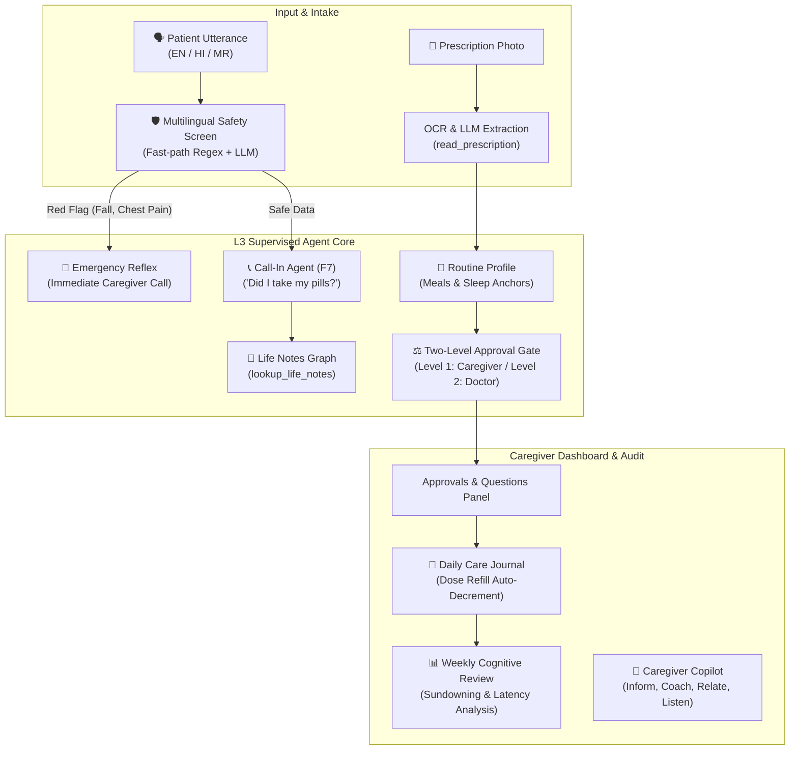

# MedTime Care Agent 🏥

> **An L3 Supervised Agentic AI Care Companion for Individuals Living with Dementia & Cognitive Impairment**  
> Developed for the **Intel AI for Future Workforce Bootcamp**

---

## 1. Overview & Problem Statement

Standard medication reminder apps rely on keypad confirmations and rigid alert chimes. For people living with mild cognitive impairment (MCI) or dementia, these interfaces fail:
1. **Uncertainty & Accidental Overdose:** Asking *"Did I take my morning pills?"* and receiving no answer can cause dangerous double-dosing.
2. **Clinical Red Flags Dismissed:** A patient experiencing orthopnea, chest tightness, or a bathroom slip may mention it casually during a routine reminder call without triggering emergency help.
3. **Rigid Schedule Friction:** Paper discharge prescriptions contain complex food rules (*before food*, *with meals*) that don't fit static clock hours.
4. **Caregiver Burnout:** Family caregivers lack continuous visibility into behavioral changes (sundowning, rising speech latency, forgotten questions).

**MedTime** bridges this gap as an **L3 Supervised AI Companion**:
- **Outside Live Calls (Person B / Anuj):** Prescription-to-Schedule OCR & routine fitting, supervised approval gates, multilingual emergency reflex screen, daily care journal with refill tracking, memory graph, and weekly cognitive trend reviews.
- **During Live Calls (Person A):** Natural voice conversations in English, Hindi, and Marathi with sub-second interruption handling (VAD).

---

## 2. System Architecture



---

## 3. Core Features & Person B Deliverables

| Feature | PRD Ref | Implementation File | Key Clinical Capability |
|---|---|---|---|
| **Caregiver Access Control** | B1.1 (C3) | `server/middleware/access.js` | Role-based hierarchy (`view < approve < primary`); link approval & revoking. |
| **Medicine Route Security & Soft Delete** | B1.3 | `server/routes/medicineRoutes.js` | Strict `PUT` field whitelist; soft delete cascading to future pending reminders. |
| **Multilingual Safety Screen** | B5 (C9) | `server/safety/screen.js` | Sub-millisecond detection of falls, chest pain, breathlessness, confusion, extra pills, self-harm, and scams across English, Hindi, and Marathi. |
| **Supervised Approval Gate** | B4 (C5, C6) | `server/models/ProposedChange.js` | No schedule change or medicine creation occurs without caregiver (Level 1) or doctor (Level 2) approval. |
| **Daily Care Journal & Refill Alerts** | B8 (C4) | `server/services/journalService.js` | Daily 9:00 PM IST summary with *"Patient said"* vs *"Agent noticed"* columns; EventBus refill decrement. |
| **Life Notes Memory Graph** | B9 | `server/models/LifeNote.js` | Grounded personal memory retrieval; zero hallucination of personal facts. |
| **"Did I take my pills?" Call-In Agent** | B11 (F7) | `server/agent/flows/callinFlow.js` | Answers dose history from verified records; hard double-dose prevention; >3 calls/hr throttling. |
| **Prescription-to-Schedule Agent** | B12 (F8) | `server/routes/ocrRoutes.js` | 5 MB upload limit, per-field confidence scores, conflict detection, routine schedule fitting. |
| **Weekly Review & Sundowning Agent** | B14 (F1, F3) | `server/services/weeklyReviewService.js` | Speech latency and repetition tracking against 4-week baseline; detects sundowning patterns. |
| **Caregiver Copilot** | B15 (F2) | `server/services/copilotService.js` | 4-mode RAG assistant (Inform, Coach, Relate, Listen); strict refusal on dosing advice. |

---

## 4. Evaluation Benchmark Results

All evaluation harnesses run locally with reproducible assertions:

| Evaluation Benchmark | Command | Sample Size | Target Metric | Achieved Result | Status |
|---|---|:---:|:---:|:---:|:---:|
| **DischargeBench 40-Persona Clinical Eval** | `node eval/runEval.js` | 40 Personas | ≥ 90% across extended set | **40 / 40 (100%)** | ✅ PASSED |
| **GrandGuard Elderly Safety Benchmark** | `node eval/grandguard/runGrandGuard.js` | 300 Utterances | Recall > 95%, Precision > 90% | **100% Recall, 100% Precision (0 FP, 0 FN)** | ✅ PASSED |
| **Multilingual Safety Screen Suite** | `node server/safety/__tests__/screen.test.js` | 71 Tests | 100% pass | **71 / 71 (100%)** | ✅ PASSED |
| **B11 Call-In & B12 Prescription Suite** | `node server/agent/__tests__/callin_and_prescription.test.js` | 19 Tests | 100% pass | **19 / 19 (100%)** | ✅ PASSED |
| **B14 Weekly Review Suite** | `node server/agent/__tests__/weekly_review.test.js` | 6 Tests | 100% pass | **6 / 6 (100%)** | ✅ PASSED |
| **B15 Caregiver Copilot Suite** | `node server/agent/__tests__/copilot.test.js` | 9 Tests | 100% pass | **9 / 9 (100%)** | ✅ PASSED |
| **Frontend Production Build** | `cd client && npm run build` | 103 modules | 0 build errors | **Clean build (1.68s)** | ✅ PASSED |

---

## 5. Prerequisites & Environment Setup

### Prerequisites
- **Node.js**: v18.x or v20.x
- **MongoDB Atlas** or local MongoDB instance
- **Groq API Key**: Free tier from [console.groq.com](https://console.groq.com)

### Environment Variables (`server/.env`)
Copy `server/.env.example` to `server/.env`:

```env
# Server Configuration
PORT=5000
NODE_ENV=development

# Database
MONGO_URI=mongodb+srv://<user>:<password>@cluster0.mongodb.net/medtime_dev_b?retryWrites=true&w=majority

# JWT & Authentication
JWT_SECRET=your_jwt_secret_key_here
JWT_EXPIRES_IN=1h
JWT_REFRESH_SECRET=your_jwt_refresh_secret_here
JWT_REFRESH_EXPIRES_IN=7d

# LLM Provider (Groq Free Tier)
LLM_PROVIDER=groq
GROQ_API_KEY=gsk_your_groq_api_key_here
LLM_MODEL_FAST=groq/llama-3.1-8b-instant
LLM_MODEL_SMART=groq/llama-3.3-70b-versatile
LLM_MODEL_SAFETY=groq/llama-3.1-8b-instant

# Telephony (Simulation Mode)
# Leave TWILIO_* values empty to run in simulation mode on your local machine
TWILIO_ACCOUNT_SID=
TWILIO_AUTH_TOKEN=
TWILIO_PHONE_NUMBER=

# URLs
PUBLIC_BASE_URL=http://localhost:5000
CLIENT_URL=http://localhost:5173
```

---

## 6. Installation & Running Locally

### Step 1: Install Dependencies
```bash
# Install server dependencies
cd server
npm install

# Install client dependencies
cd ../client
npm install
cd ..
```

### Step 2: Seed the Database
Populates Ramesh Kulkarni's clinical discharge scenario:
```bash
node server/scripts/seed.js
```

### Step 3: Start the Backend & Frontend
```bash
# Terminal 1: Backend Server (runs on http://localhost:5000)
cd server
npm run dev

# Terminal 2: Frontend Client (runs on http://localhost:5173)
cd client
npm run dev
```

---

## 7. Running Evaluation Harnesses

Run the complete evaluation suite with single commands:

```bash
# 1. Run the Full 40-Persona Clinical Evaluation Benchmark (B13)
node eval/runEval.js

# 2. Run the GrandGuard 300-Item Safety Benchmark (B13.2)
node eval/grandguard/runGrandGuard.js

# 3. Run the Safety Screen Unit Test Suite
cd server && node safety/__tests__/screen.test.js && cd ..

# 4. Run the Call-In & Prescription Unit Test Suite
cd server && node agent/__tests__/callin_and_prescription.test.js && cd ..

# 5. Run the Weekly Review & Sundowning Test Suite
cd server && node agent/__tests__/weekly_review.test.js && cd ..

# 6. Run the Caregiver Copilot Test Suite
cd server && node agent/__tests__/copilot.test.js && cd ..
```

---

## 8. Live Demo Runbook

Follow the complete 5–7 minute live demonstration script in **[docs/DEMO_SCRIPT.md](docs/DEMO_SCRIPT.md)**.

For caregiver usability testing, refer to the 10-item System Usability Scale instrument in **[docs/SUS_EVALUATION_FORM.md](docs/SUS_EVALUATION_FORM.md)**.
