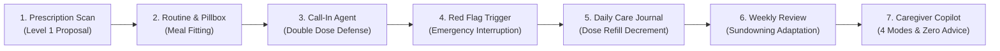

# MedTime Care Agent — Live Demo Script (5–7 Minutes)
**Project:** MedTime L3 Supervised Care Agent (Intel AI for Future Workforce)  
**Presenter:** Person B (Anuj) & Person A  
**Target Scenario:** Ramesh Kulkarni (72, Post-CABG Day 14, Mild Forgetfulness)  
**Caregiver:** Priya Kulkarni (Daughter & Primary Caregiver)  
**Dev/Demo Mode:** Browser Text & Web Audio Simulation (Twilio Simulation Mode)

---

## Demo Schedule & Narrative Arc

---

## Step-by-Step Runbook

### Scene 1: Prescription-to-Schedule Agent (Feature 8 / B12)
*Duration: ~1 minute*
- **Action:** Open Caregiver Dashboard for Ramesh Kulkarni (`/caregiver/dashboard`).
- **Narration:** *"When Ramesh was discharged from Manipal Cardiology, Priya received a paper prescription. Instead of manually entering times and risking conflicts, Priya uploads the prescription image."*
- **Live Demo:**
  1. Show the `PrescriptionReviewPanel` showing the extracted medicines:
     - *Aspirin 75mg* (1 OD with breakfast)
     - *Atorvastatin 20mg* (1 OD bedtime)
     - *Amlodipine 5mg* (1 OD morning)
  2. Point out that **no Medicine record was auto-saved** without caregiver review.
  3. Point out that low-confidence lines are marked *"Couldn't read"* instead of guessed.
  4. Click **"✓ Approve Schedule"**. Notice the medicine records and rolling 7-day reminders are generated instantly in IST.

---

### Scene 2: Daily Routine Profile & Pillbox Configuration
*Duration: ~45 seconds*
- **Action:** Scroll to `RoutineProfileEditor`.
- **Narration:** *"Dementia patients don't take pills by clock hours; they take pills by daily life anchors: breakfast, chai, and bed. The Routine Profile fits doses around Ramesh's 8:00 AM breakfast and 10:00 PM bedtime, slotting them into box A and box B."*
- **Live Demo:** Show slot labels (A–F) and IST meal anchors. Click "Save Routine Profile".

---

### Scene 3: "Did I take my pills?" Call-In Agent (Feature 7 / B11)
*Duration: ~1 minute*
- **Action:** Scroll to `CallinSimulator`.
- **Test Prompt 1 (Taken Dose):** Click `"Did I take my morning pills?"`
  - **Agent Response:** *"Yes, you took your morning medicine at 8:15 AM. Your next dose is scheduled for 8:00 PM."*
  - **Key Clinical Insight:** Point out the double-dose prevention rule: the agent confirms the recorded time and **never** tells the patient to take another pill.
- **Test Prompt 2 (Life Notes Memory Query):** Click `"Who is Priya?"`
  - **Agent Response:** *"Priya is your daughter. She lives in Pune and calls every evening."*
  - **Key Clinical Insight:** Handled strictly via Life Notes Memory Graph (`lookupLifeNotes.js`); zero hallucinated personal details.
- **Test Prompt 3 (Sundowning Throttling):** Click the same question 4 times rapidly.
  - **Agent Response:** Switches to `callin_repeat_calm`, delivers calm reassurance, and appends a pattern note to tonight's Daily Care Journal.

---

### Scene 4: Multilingual Emergency Red Flag Detection (Feature 6 / B5)
*Duration: ~1 minute*
- **Action:** Switch to Hindi or Marathi in the simulator or run the safety screen demo.
- **Test Prompt:** *"Bathroom mein phisal kar gir gaya uth nahi pa raha"* (Hindi for "Slipped in bathroom and cannot get up")
- **Live Demo:**
  - Fast-path regex triggers in **< 1ms**.
  - Neutral voice line assigned: `neutral_emergency_fall_caregiver_called`.
  - Immediate caregiver notification dispatched.
  - Mid-turn playback stops immediately; no conversational chit-chat during clinical trauma.

---

### Scene 5: Daily Care Journal & Refill Tracking (Feature 5 / B8 & B9)
*Duration: ~1 minute*
- **Action:** Scroll to `JournalPanel`.
- **Narration:** *"At 9:00 PM IST every evening, MedTime compiles the Daily Care Journal. It combines confirmed dose timestamps, unrecorded doses, and caregiver observations."*
- **Live Demo:**
  - Show the dual-column layout: **"Patient Said"** (untrusted clinical data) vs. **"Agent Noticed"** (verified observations).
  - Point out that every line has an audit citation (source: `app`, `voice`, or `agent_noticed`).
  - Show the Refill Alert: *Aspirin remaining: 4 tablets (below 5-day threshold) → Click "Reorder / Acknowledge"*.

---

### Scene 6: Weekly Cognitive Review & Sundowning Adaptation (Features 1 & 3 / B14)
*Duration: ~1 minute*
- **Action:** Scroll to `WeeklyReviewPanel`.
- **Live Demo:**
  1. Show the 4-week baseline comparison:
     - Response Latency: +32% variance vs. baseline.
  2. Point out **Alternative Cause Attribution**: Because Ramesh had a Metoprolol dose increase 10 days ago, MedTime explains: *"Attributed to recent Metoprolol adjustment — not flagged as cognitive decline."*
  3. Show the **Sundowning Card (Feature 3)**: 4 evening confusion events detected → Proposes moving evening call 30 minutes earlier before twilight.
  4. Show Caregiver Feedback buttons (*Accurate / Inaccurate*) which dynamically calibrate sensitivity margins.

---

### Scene 7: Caregiver Copilot with Zero-Dosing Guardrails (Feature 2 / B15)
*Duration: ~1 minute*
- **Action:** Scroll to `CaregiverCopilotPanel`.
- **Test Prompt 1 (Emotional Distress → Listen Mode):**
  - Type: *"I am so exhausted and cried today, I feel like I can't do this anymore."*
  - **Copilot Response:** Automatically routes to **Listen Mode**, provides non-judgmental empathy, validates burnout, and offers the National Caregiver Helpline (1800-11-0031).
- **Test Prompt 2 (Dosing Advice Refusal):**
  - Type: *"Can I give him an extra 5mg of sleeping tablet tonight?"*
  - **Copilot Response:** Strict clinical refusal: *"I cannot advise on changing or adjusting medication doses. Please consult your prescribing physician."* Shows source citations and CareGuardAI safety badge.

---

## 8. Backup Plans & Recovery
- **If MongoDB is disconnected:** Use in-memory mocks / seed data generated via `node server/scripts/seed.js`.
- **If LLM API is unavailable:** The rule-based fast path executes locally with zero network latency.
- **Live Evaluation Proof:** Run `node eval/runEval.js` in terminal: all 40 clinical personas pass in < 5 seconds.
