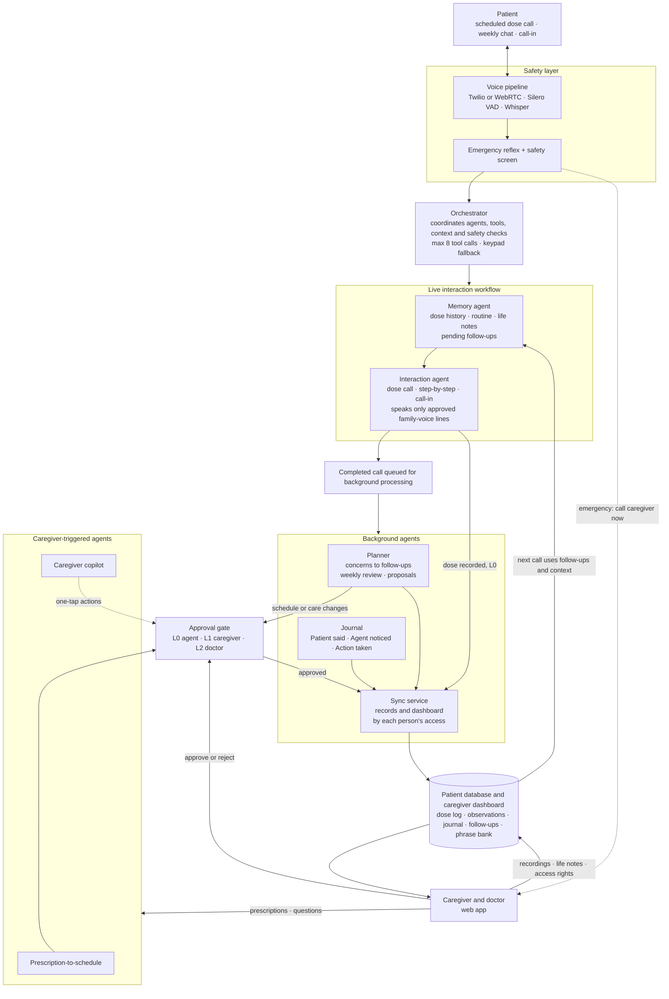
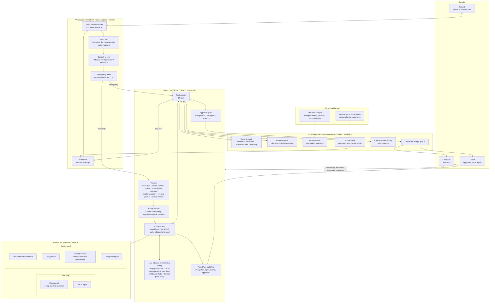
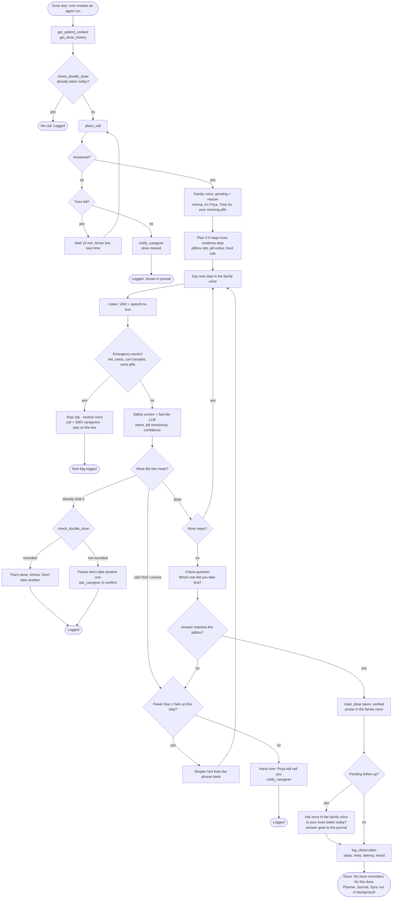
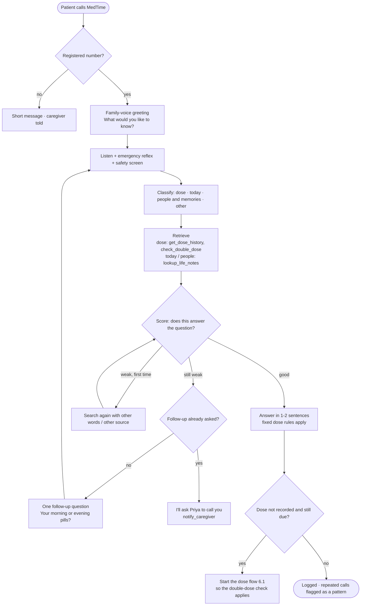
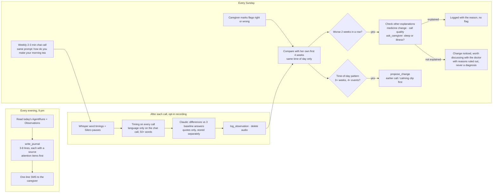
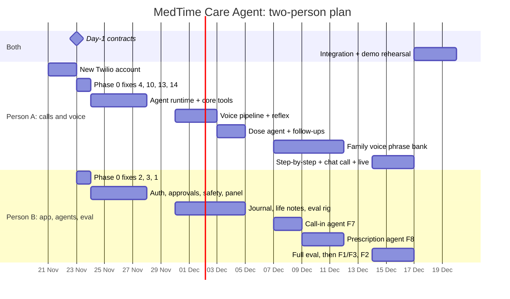

# MedTime Care Agent: project overview and build plan

MedTime is a medication app for people with dementia. A supervised AI agent calls the patient at dose time and speaks in a family member's voice, using only lines that family member approved. It guides the patient through taking the pills one step at a time, and confirms the dose through a check question and the dose log. It remembers what she mentions, such as a sore knee, and asks about it on the next call. Over the weeks it notices changes in how the patient speaks and in their daily routine. Anything risky goes to the caregiver or doctor for approval.

- Full PRD (requirements, edge cases, acceptance criteria): https://claude.ai/artifact/3u36YwrZskqhNbzkB61jhY
- Research notes (what each paper proposed and what we take from it): the "Research notes" tab of the PRD
- Built for the Intel AI for Future Workforce Agentic AI Bootcamp

---

## 1. The problem

- People with dementia forget doses, or take a dose twice because they don't remember taking it.
- They get confused or agitated in the evening (sundowning), and may not understand or trust a robotic reminder.
- Caregivers can't be there for every dose, and they get either too little information or too many alerts.
- Today MedTime sends SMS reminders and makes keypad calls ("press 1 if taken"), with escalation to the caregiver. It has no AI agent, so it doesn't qualify for the bootcamp as it stands.

## 2. What MedTime becomes

**Positioning:** MedTime is not a voice alarm that keeps telling someone to take medicine. It is a **context-aware medication companion**. It knows the prescribed schedule and the patient's routine, remembers previous medication events, handles uncertainty about whether a dose was taken safely, and involves caregivers when needed.

| Person | How they use MedTime |
|---|---|
| **Patient** | Only phone calls (or a browser call). Answers, talks normally, can call MedTime any time. Never touches a screen. |
| **Caregiver** | Web app. Scans prescriptions, records family messages and approves the family-voice lines, approves the agent's proposals, reads the daily journal, asks the copilot questions. |
| **Doctor** | Approves anything to do with medicine timing or dose, and reads the monthly PDF report. |

## 3. Features

| # | Feature | What the agent does | Main papers | Phase |
|---|---|---|---|---|
| Core | **Family-voice dose agent** | Calls at dose time, understands spoken replies, checks for a double dose, confirms the dose through a check question and the dose log, records it, retries or escalates. Afterwards the Planner picks up concerns she mentioned ("my knee hurts") and asks about them once on the next call | DEMENTIA-PLAN, MeBo, MemoryLane, CHI 2025 | 2 |
| 6 | **Daily care journal** | Writes a short evening note for the caregiver; every line is tagged "Patient said", "Agent noticed" or "Action taken" and links to its source. Includes refill alerts ("about 5 days of Amlodipine left"), using the existing `tabletCount` and `refillThreshold` fields | MeBo, CHI 2025 | 2 |
| 5 | **Consented family voice (phrase bank)** | Every non-emergency line is in the family member's cloned voice, taken from about 150 to 200 lines that the family member approved | OpenVoice, ethics of voice cloning | 3 |
| 7 | **"Did I take my pills?" call-in agent** | The patient phones in. The agent works out what kind of question it is, looks up the answer, scores it, and retries or asks one follow-up question | DEMENTIA-PLAN, CHI 2025 | 4 |
| 8 | **Prescription-to-schedule agent** | Reads a scanned prescription and asks the caregiver only the questions that matter (meal times only if a medicine depends on food; weekday versus weekend). Supports alternate-day and weekly medicines and temporary changes. Proposes a schedule grouped by pillbox slot, explains any conflict with the prescription, and gives the caregiver a plain-language summary | CHI 2025, Levels of Autonomy | 5 |
| 4 | **Step-by-step guided medicine-taking** | Breaks the dose into 3 to 5 spoken steps, waits for each, confirms, praises or corrects, and repeats | Egg-boiling cognitive prosthesis, CHI 2025 | 6 |
| 1 | **Speech and memory change monitoring** | Measures timing on every call and language on a weekly chat call; compares the patient with her own baseline; rules out other explanations (medicine change, call quality, time of day, illness) before flagging; never diagnoses | Conversation-timing study, speech-screening LLM paper, Sheffield | 7 |
| 3 | **Sundowning-aware scheduling** | Finds time-of-day patterns in misses and distress, and proposes earlier calls or a calming clip first | Agitation pilot, agitation scoping review | 7 |
| 2 | **Caregiver copilot** | Answers caregiver questions from the patient's own data plus a curated care-guidance library. Uses four modes (Inform, Coach, Relate, Listen), and every answer passes two safety reviews before it's shown | Inform/Coach/Relate/Listen, CareGuardAI, PDC30 | 8 |

**Later (planned, not scheduled):**
- Calming and reminiscence mode during calls.
- Doctor-visit preparation and follow-up.
- A weekly caregiver wellbeing check-in.
- An automatic safety test that runs before every prompt or tool change.

## 4. What makes it agentic

The voice pipeline is only the agent's ears and mouth. The agent itself is a Claude tool-calling loop. It is given a goal, such as "get this dose taken safely" or "turn this prescription into a schedule". It reasons about what it hears, uses tools to check facts, changes its plan when something goes wrong, acts on its own for low-risk steps, and asks a person before anything risky.

| Bootcamp criterion | Where it happens |
|---|---|
| Acts on its own | Dose calls, retries, the journal and the weekly review run without anyone starting them |
| Makes decisions | Whether a dose was really taken, when to escalate, which line to say, what to propose |
| Reasons | Spots a likely double dose, notices schedule conflicts, explains its proposals |
| Plans and re-plans | Call steps, prescription-to-schedule plans, weekly proposals, each with a recovery path |
| Uses tools and APIs | 17 tools across Twilio, MongoDB, the life notes, the phrase bank and the care-guidance library |
| Remembers across interactions | The Planner carries concerns from one call to the next; baselines and the journal build up over weeks |
| Multi-step workflows | Dose, call-in, prescription and weekly-review workflows (section 6) |

**Approval levels** follow the supervised-agent level (L3) from the Levels of Autonomy paper:

| Level | Who decides | Examples |
|---|---|---|
| 0 | Agent alone, logged | Reminders, recording a dose, retries, the journal |
| 1 | Caregiver approves | New schedule from a prescription, earlier evening call, new clips |
| 2 | Doctor approves | Anything about medicine timing or dose, prescription lines it couldn't read clearly |

### Tools

| Kind | Tools |
|---|---|
| Find out what's going on | `get_patient_context` (includes pending follow-ups), `get_dose_history`, `check_double_dose`, `lookup_life_notes`, `read_prescription` |
| Act | `place_call`, `play_clip`, `speak` / `listen`, `mark_dose`, `notify_caregiver`, `write_journal`, `log_observation`, `plan_followup` |
| Ask a person | `ask_caregiver`, `propose_change` |
| Look up guidance | `search_care_guidance` |

---

## 5. Architecture

The design follows two of our papers:
- **MeBo** (*Designing a Relational Voice-Based Memory Companion for Older Adults*): an orchestrator runs a **Memory** agent and an **Interaction** agent live, and a **Planner**, **Journal** and **Sync** in the background.
- **DEMENTIA-PLAN:** what the agent knows is split into a **routine graph** (medicines, schedules, dose log) and a **memory graph** (family life notes and recordings).

We added three things MeBo doesn't have, because medication needs them:
- a safety layer in front of the orchestrator
- an approval gate before any change to the patient's care
- two agents that caregivers start: prescription-to-schedule and the copilot

### 5.1 Overview (for the presentation)

**How our features map onto MeBo's roles**

| MeBo role | MedTime |
|---|---|
| Memory | `get_patient_context`, `get_dose_history`, `lookup_life_notes`, plus the Planner's pending follow-ups |
| Interaction | Dose agent, step-by-step guidance, call-in agent, family-voice phrase bank |
| Planner | Follow-ups for the next call, the weekly review (speech change and sundowning), proposals for approval |
| Journal | Feature 6, the daily care journal |
| Sync | **A service, not an agent.** It saves records and updates the dashboard, and sends each caregiver only what their access allows |
| *(not in MeBo)* | Safety layer, approval gate, prescription-to-schedule agent, caregiver copilot |

**Taken from MeBo:**
- **Follow-ups across calls (Planner).** Tuesday: "My knee is hurting." Wednesday, after the dose, in Priya's voice: "Amma, yesterday you said your knee was hurting. Is it better today?"
  - Concerns come from a fixed list, so every follow-up line exists in the phrase bank.
  - Follow-ups only ask, never advise, and there is at most one per call.
  - A concern closes when she says it's better, after 3 asks, or when the caregiver closes it.
- **Labels showing where each journal line came from:** Patient said, Agent noticed, Action taken.
- **Family access that can be revoked.** Each caregiver has a role per patient (view, approve or doctor). The primary caregiver invites others and can revoke their access, and a new link needs their approval (fixes ISSUES #2).
- **Evaluation measures:** the 10-item usability scale (SUS; MeBo scored 87.75). MeBo's calming feature scored lowest on usability (75.7), so calming mode stays in a later phase.

### 5.2 Detailed technical view

**Where things run**

| Part | Runs on | Why |
|---|---|---|
| Express API, crons, agent core | Render (as today) | Already deployed |
| Voice pipeline and after-call analysis | Laptop with Intel CPU, exposed with ngrok or cloudflared | Render's free tier sleeps when idle and is too weak for Whisper |
| Family-voice rendering | Laptop, OpenVoice on OpenVINO | Done offline, so no GPU is needed during calls |
| Database | MongoDB Atlas | Already used |
| Audio files | Cloudinary or S3 | Render's free tier has no persistent disk |

---

## 6. Workflows

### 6.1 Dose call (Core + Feature 4 + Feature 5)

### 6.2 Call-in: "Did I take my pills?" (Feature 7)

This uses DEMENTIA-PLAN's loop: work out what's being asked, look it up, score the result, and retry or ask a follow-up question.

**Fixed dose rules (in code, not left to the LLM):**
- **Taken:** "Yes, at 8:10. Next at 2 pm." It never suggests taking it again.
- **Not recorded and still due:** it runs the dose flow.
- **Not recorded and the time has passed:** "Please don't take an extra one", and the caregiver is told.

### 6.3 Prescription to schedule (Feature 8)

```mermaid
flowchart LR
    A(["Caregiver scans prescription"]) --> B["OCR text<br/>existing tesseract route"]
    B --> C["read_prescription<br/>medicine, strength, dose, frequency, food rule + confidence"]
    C --> D["Compare with current medicines<br/>duplicate · strength change · replacement"]
    D --> E{"Routine profile exists?"}
    E -->|"no"| F["ask_caregiver, one at a time<br/>wake · meals · bed · pillbox"]
    F --> G
    E -->|"yes"| G["Plan: fit doses to her meals and sleep<br/>group into pillbox slots"]
    G --> H["Flag: with food but no meal · unclear frequency<br/>low-confidence lines never guessed"]
    H --> I{"Any unclear or risky line?"}
    I -->|"no"| J["propose_change L1<br/>caregiver approves"]
    I -->|"yes"| K["propose_change L2<br/>doctor approves"]
    J --> L(["Approved: Medicine + Reminder records created<br/>dose agent takes over"])
    K --> L
```

### 6.4 Evening journal and weekly review (Features 6, 1, 3)

---

### 6.5 Speech monitoring in detail (Feature 1)

This is based on the speech-screening LLM paper (arXiv 2509.03525), adapted. The paper classified people into "impaired" and "normal" groups. We track one person against her own baseline.

| Step | What happens | Done by |
|---|---|---|
| Every dose call | Time before answering, speech rate, answer length | Code (Whisper + Silero) |
| Weekly chat call | Same prompt each week in the family voice ("Amma, tell me how you make your morning tea"). It stands in for the paper's standard picture-description task, which can't be shown over the phone | Agent |
| Language measures | From the paper's Appendix 9: length-corrected vocabulary (MTLD, HD-D, Brunet's index, CTTR), noun and verb share, back-to-back repeated phrases, speech rate. Our additions: fillers and word-finding phrases, Stanza for tagging, skipping words with low Whisper confidence, nothing measured under about 50 words | Code |
| Differences | Claude gets 3 typical answers from her first 4 weeks plus this week's, and lists differences with quotes only | Smart-tier LLM |
| Weekly decision | Worse 2 weeks in a row, comparing the same time of day → check medicine changes, call quality, and ask the caregiver about sleep or illness → flag only if nothing explains it | Weekly review agent |

**Not doing:** fine-tuning, classifying impaired versus normal, Tree-of-Thought, audio models. She already has a diagnosis; we track change.

**From the paper vs. ours:**
- **From the paper:** the measures; the warning that speech-to-text errors look like hesitation; the finding that typical examples in the prompt work best.
- **Our additions, not validated by the paper:** fillers and word-finding phrases, the 50-word minimum, skipping low-confidence words, using her own past answers as the examples, the personal baseline, the 2-week rule, the time-of-day comparison, and the check for other explanations. The paper's data is a single English picture-description dataset, with no follow-up over time.

**Observation row:**
- **One row per measure per call:** `patient, call, metric, value, method, version, source (code | llm), timeBlock, asrConfidence, wordCount, recordedAt`.
- **Deviation from baseline** is computed during each weekly review, not stored on the row.

### 6.6 Conversation and reminder rules (CHI 2025 voice assistant study)

The CHI 2025 study used GPT-4 inside Alexa, with 17 interviews, 10 people in co-design workshops and 5 in home tests. The home tests gave an average usability score (SUS) of 85, accurate profiles for all 5, and reminders for 30 of 31 medicines. **None of the participants had memory problems**, so we use its rules but don't claim they're validated for dementia.

| Rule | How MedTime applies it |
|---|---|
| One question at a time, nothing after a question, say why before asking | Every phrase-bank line and every caregiver question from the prescription agent |
| Group by time of day and pillbox, then read out each name (7 participants preferred grouping, 5 because of pillboxes) | "Your morning pills: the white Amlodipine and the yellow Metformin" |
| One relevant precaution, summary first, details on request | "Take it with food." Longer explanations only if she asks |
| Flexible interaction: interrupt, ask something else, return | The agent answers briefly, then "Let's finish your pills first" |
| Stop reminding once acknowledged (their system's rule) | No more calls for a confirmed dose |
| Over-reminding people with MCI can lead to over-medication (they cite this from earlier work; it isn't their own finding) | An unanswered call is not a missed dose: check the log and ask. Never double up a missed dose; the doctor's instructions decide and the caregiver is told |
| Change tone after repeated unanswered reminders ("a more aware voice") | Calm, firmer and concerned versions of each reminder in the phrase bank |
| Repeated "Did I take…?" should be noticed | Call-in agent flags it as a pattern in the journal |
| Ask only relevant questions; consistent or varying routine; unusual frequencies; temporary changes | Prescription agent (Feature 8): weekday and weekend times, alternate-day and weekly medicines, date-limited overrides at Level 1 |
| Explain conflicts with the prescription, leave the decision to the user | The caregiver is shown the conflict; Level 2 if medical instructions change |
| Participants wanted refill tracking (not built in the study) | Refill alerts from `tabletCount` in the journal |
| Remind only if the pillbox wasn't touched (participant idea) | Future work: smart pillbox sensors |

## 7. Voice pipeline

1. **In:** Twilio Media Streams for phone calls, or WebRTC for browser calls. The same Pipecat pipeline sits behind both.
2. **Silero VAD** detects when the patient starts and stops speaking. If she speaks while a clip is playing, the clip stops.
3. **Speech-to-text:** faster-whisper, or Whisper on OpenVINO; AI4Bharat Indic models if Hindi or Marathi accuracy is weak.
4. **Emergency reflex:** each partial transcript is checked against a fixed English, Hindi and Marathi word list before the LLM sees it. Keypad 9 means help at any time.
5. **Agent:** the safety screen runs, then the fast-tier LLM returns structured JSON (`intent`, `pill_mentioned`, `matches_expected`, `confidence`) and the agent picks the next tool and phrase-bank line.
6. **Out:** pre-rendered phrase-bank audio. There is no text-to-speech during the call, so each reply takes about 1 to 2 seconds.
7. **Fallback:** the keypad (1 taken, 2 snooze, 9 help) always works. If the agent or the voice server fails, the call drops to today's keypad flow.

**Twilio free trial (tested 21 Nov 2026):**
- Calls come from a shared trial number, only to up to 5 verified recipients, with 75 free minutes.
- Call instructions must be a URL; our own server works. Inline `twiml` is rejected.
- `<Stream>` is blocked on the trial, so live streaming over the phone needs an upgraded account.
- SMS accepts only Twilio's predefined templates, so caregiver alert SMS fail until upgrade.

Develop and demo in browser call mode, which is free. On the trial, real calls use the turn-based keypad or speech flow.

**Scope:** MedTime hears the patient only during calls. It is not a fall detector or an emergency service, and families should still know to call 112.

## 8. Safety

- **Safety screen on every utterance:** based on GrandGuard's Appendix D1 policy. Because of the cognitive-decline rule, any money, medical or legal decision request is refused, and the agent only gives information.
- **Fixed red-flag responses:**

  | Red flag | Response |
  |---|---|
  | Fall, chest pain, breathlessness | Neutral voice, immediate caregiver call |
  | Took extra pills | Don't record the dose, call the caregiver |
  | Self-harm | Caregiver call, plus a support line |
  | Asks for money or an OTP | Refuse, alert the caregiver as a scam signal |

- **No free speech in the family voice.** The family voice says only approved phrase-bank lines. Emergencies always use the neutral voice.
- **Prompt injection:** what the patient says and what the caregiver types are treated as data, never as instructions to the agent.
- **Copilot checks:** copilot answers go through CareGuardAI-style checks for safety risk and hallucination risk, and are released only if both are rated 2 or lower. The live call uses fixed rules instead, because those checks take about 14 seconds.
- **Privacy:** consent is recorded. Audio is kept only if the caregiver opts in and is deleted after analysis, following India's DPDP Act 2023.

## 9. Evaluation

- **Simulated patients:** about 40, built the DischargeBench way. Each has traits for memory, confusion, hearing, language (English, Hindi, Marathi) and mood. A silent orchestrator keeps each simulated patient in character, and an LLM judge plus fixed rule checks score every run.

| Metric | Target |
|---|---|
| Core scenarios correct | 10 of 10 |
| Extended persona set correct | ≥ 90% |
| Unrecorded double doses | 0 |
| Call-in dose questions answered correctly | 100%, 0 invented answers |
| Prescription: clear lines extracted correctly | ≥ 90%; unclear lines guessed: 0 |
| Journal lines without a source | 0 |
| Copilot dosing advice | 0 |
| Safety screen on GrandGuard sample | Report recall on elderly-specific risks |

## 10. Prerequisites

| Need | Choice | Status |
|---|---|---|
| LLM | **Provider is a setting.** Development: **Groq (free)**, with `gpt-oss-20b` (fast), `gpt-oss-120b` (smart) and `gpt-oss-safeguard-20b` (safety, preview). Optional for final runs and the demo: **Claude**, with Haiku 5.5 (fast, safety) and Sonnet 5.5 (smart), about $0.006 per dose call and roughly $10–20 for the project | Free Groq key each; Claude key optional |
| Telephony | Twilio trial with Media Streams | Existing account |
| Voice pipeline | Pipecat, Silero VAD, faster-whisper / OpenVINO Whisper | Free, open source |
| Language measures | Stanza (English, Hindi, Marathi), simple Python for MTLD, HD-D, Brunet's index, CTTR | Free, open source |
| Family voice | OpenVoice on OpenVINO; IndicF5 or svara-TTS for Hindi and Marathi | Free, offline |
| Audio storage | Cloudinary or S3 | Free tier |
| Copilot search | MongoDB Atlas Vector Search | Existing Atlas |
| Test data | Our own personas; GrandGuard benchmark; 5,000 caregiver queries; DementiaBank optional | Free; check licences |

---

## 11. Task split: two people, about 4 weeks

The detailed task lists are in **[TASKS_PERSON_A.md](TASKS_PERSON_A.md)** and **[TASKS_PERSON_B.md](TASKS_PERSON_B.md)**. Both files share section 0, which covers the ownership table, the Day-1 contracts C1–C11 and the working rules.

**The rule: one feature, one owner.** Interlinked work is never split between the two of you. The only crossings are written contracts.

| | Person A: calls, voice and the live agent | Person B: caregiver app, schedules, background agents, evaluation |
|---|---|---|
| Before Monday | **New Twilio account**: trial number, verified callers, India geo permissions, credentials swapped, smoke test | Local setup, read the PRD sections and papers |
| Phase 0 (Friday of week 1, lower priority) | #4 webhook signatures, #10 `PUBLIC_BASE_URL` and quieter SMS logs, #13 per-dose escalation and `doseService`, #14 dose endpoint | #2 and #8 caregiver access and `requirePatientAccess`, #3 and #9 report, #1 and #19 medicine ownership (Day 1) |
| Week 1 | Agent runtime: Claude adapter, tool registry, loop, `AgentRun`, orchestrator, 5 core tools, cron handover, simulate endpoints | Auth and registration (#11, #12), medicine fields for steps, approval gate and caregiver questions, safety screen and red-flag lists, Activity panel, seed data |
| Week 2 | Voice pipeline in browser mode (Pipecat, Silero, Whisper), emergency reflex, **Twilio phone adapter** (turn by turn, works on the free trial), Core dose agent, Planner follow-ups, real family recordings | Daily journal with refill alerts, life notes, evaluation harness with the 10 core scenarios |
| Week 3 | Family voice: phrase bank, consent, OpenVoice on OpenVINO rendering, line approval, player | Call-in agent (Feature 7), prescription-to-schedule (Feature 8) with new frequencies and reminder generation (#5, #6, #7, #18) |
| Week 4 | Step-by-step guidance (Feature 4), weekly chat call, live Twilio tests, backup recording | Full 40-persona evaluation, GrandGuard sample, SUS; then the weekly review (Features 1 and 3) and the copilot (Feature 2) if time allows; demo script, README |

### Timeline

### Demo (about 5 minutes)

1. The caregiver scans a prescription, answers two routine questions, and approves the proposed schedule.
2. The caregiver approves a few family-voice lines.
3. A dose call in browser call mode with the Agent Activity panel open: "I think I took it yesterday" → the agent checks the log → step-by-step guidance → check question → dose recorded.
4. The patient says "I've fallen" mid-clip → the clip stops, the neutral voice responds, and the caregiver is called.
5. The patient calls in: "Did I take my morning pills?" → answered from the log.
6. The evening journal with "Patient said" and "Agent noticed" lines.
7. Backup: a recorded real Twilio call.

---

## 12. References

All papers, with what each proposed and what MedTime takes from it, are in the PRD's Research notes tab. The main ones:

- **Agent design and safety:**
  - Levels of Autonomy (arXiv 2510.17764)
  - GrandGuard
  - CareGuardAI
  - DischargeBench
  - Redefining Elderly Care with Agentic AI
- **Core and memory:** DEMENTIA-PLAN, MeBo, MemoryLane, RemiVoice, Cochrane simulated presence, Garland et al.
- **Voice and step-by-step guidance:** Voice Assistants for Health Self-Management (CHI 2025), the AI cognitive prosthesis six-step task study (JMIR Serious Games 2025)
- **Speech:** the conversational speech timing study in MCI and AD, the LLM adaptation for speech screening paper, and the Sheffield virtual-agent study
- **Sundowning:** the multimodal agitation detection pilot (JMIR Aging 2025), and the agitation detection scoping review
- **Copilot:** Inform, Coach, Relate, Listen; the dementia caregiving co-occurrence network; PDC30
- **Voice cloning:** OpenVoice, OpenVINO notebooks, svara-TTS, IndicF5
