# MedTime Care Agent — Overall Project Status: What's Done vs. What's Left

**Project:** MedTime Care Agent (Intel AI for Future Workforce Agentic AI Bootcamp)  
**Repository:** `shravanidhus31/MedTime`  
**Current Active Branch:** `Anuj` (Person B)  
**Date:** November 2026  

---

## 1. Executive Summary

MedTime is evolving from a standard keypad SMS/call reminder platform into an **L3 Supervised Agentic AI Care Companion** for individuals living with dementia. 

- **Person A** builds what happens **during phone calls**: voice pipeline, agent loop, phone adapter, phrase bank, and live dose conversation.
- **Person B (Anuj)** builds what happens **outside live calls & in the web app**: schedules, caregiver access, approval gate, safety screen, care journal, memory graph, call-in agent, prescription agent, and evaluation harness.

---

## 2. Overall Status Matrix

```mermaid
flowchart TD
    subgraph S1["Phase 0 & Foundations (Week 1)"]
        D1["✅ Caregiver Access B1.1 (C3)"]
        D2["✅ Medicine Route Security & Soft Delete B1.3"]
        D3["✅ Report Adherence Fixes B1.2"]
        D4["✅ Nightly Reminder Top-Up B1.4"]
        D5["✅ Token Refresh & Registration UI B2"]
        D6["✅ Step-by-Step Guidance Fields B3 (C10)"]
        D7["✅ Approval Gate & Questions B4 (C5, C6)"]
        D8["✅ Multilingual Safety Screen B5 (C9)"]
        D9["✅ Seed Script B7"]
        D10["✅ Agent Activity Panel B6"]
    end

    subgraph S2["Phase 2: Memory & Journal (Week 2)"]
        B8["✅ B8: Daily Care Journal & Refill Alerts (C4)"]
        B9["✅ B9: Life Notes Memory Graph"]
        B10["✅ B10: 10-Persona DischargeBench Eval Harness"]
    end

    subgraph S3["Phases 3-5: Live Features (Week 3)"]
        B11["✅ B11: 'Did I take my pills?' Call-In Agent & C7 Lines"]
        B12["✅ B12: Prescription-to-Schedule Agent & Routine Profile"]
        B12U["✅ B12: 20 Synthetic Benchmark Prescriptions"]
    end

    subgraph S4["Phase 6+: Eval & Demo (Week 4)"]
        B13["⏳ B13: Full 40-Persona Evaluation Benchmark & SUS"]
        B14["⏳ B14: Weekly Review (Speech & Sundowning Analysis Worker)"]
        B15["⏳ B15: Caregiver Copilot"]
        B16["⏳ B16: Demo Rehearsal & Final Documentation (#20)"]
    end

    S1 --> S2 --> S3 --> S4
```

---

## 3. What Has Been Completed (DONE)

### A. Week 1 Deliverables (Phase 0 & 1 Foundations)
- [x] **Caregiver Access Control (B1.1, Contract C3):** `CaregiverAccess` model, `caregiverRoutes.js` link request/approve/revoke flows, `requirePatientAccess('view'|'approve'|'primary')` middleware.
- [x] **Medicine Route Security & Soft Delete (B1.3):** Whitelist on `PUT`, soft delete with `isActive: false`, `deletedAt`, `deletedBy`, cascades to pending future reminders. Removed dead duplicate DELETE route (#19).
- [x] **Monthly Adherence Report (B1.2):** True adherence calculation, excludes soft-deleted records.
- [x] **Nightly Reminder Top-Up (B1.4 / #5):** Cron job ensuring a rolling 7-day window of reminders, idempotent.
- [x] **Token Refresh & Registration Flow (B2 / #11, #12):** Token refresh endpoint and automatic interceptor, patient/caregiver registration tabs, `CaregiverLinkPage` and `PendingApprovalsPage`.
- [x] **Step-by-Step Guidance Fields (B3 / Contract C10):** `pillDescription`, `pillboxSlot`, `locationHint` on `Medicine` model and UI form.
- [x] **Supervised Agent Architecture & Gating (B4 / Contracts C5, C6):** `ProposedChange` model, `AgentQuestion` model, `ApprovalsPanel.jsx`, `QuestionsPanel.jsx`.
- [x] **Multilingual Safety Screen (B5 / Contract C9):** `server/safety/redflags.json` across 7 categories (fall, chest pain, breathlessness, confusion, extra pills, self harm, scams) in English, Hindi, and Marathi. 71/71 tests passing.
- [x] **Agent Activity Panel & Audit Trail (B6 / Contract C2):** `AgentRun` model, `agentRunRoutes.js`, `ActivityPanel.jsx`.
- [x] **Demo Seed Script (B7):** `server/scripts/seed.js` with full Ramesh Kulkarni clinical scenario.

### B. Week 2 Deliverables (Phase 2 Memory & Journal)
- [x] **Daily Care Journal & EventBus Refills (B8, B9, Contract C4):** `DailyJournal` model, `journalService.js` (rule-based aggregation + Groq LLM clinical summary), nightly 9:00 PM IST cron, EventBus listener for `dose.taken` auto-decrementing refills.
- [x] **Life Notes Memory Graph (B9):** `LifeNote` model, REST endpoints, `LifeNotesEditor.jsx` graph viewer with category badges and privacy controls.
- [x] **DischargeBench 10-Persona Clinical Evaluation Harness (B10):** Black-box evaluation runner `eval/runEval.js`, 10 core clinical personas (`eval/personas/persona_01.json` through `persona_10.json`), rubric judge, markdown report generation. **10/10 PASS (100%)**.

### C. Week 3 Deliverables (Phases 3-5 Call-In & Prescription Agents)
- [x] **"Did I take my pills?" Call-In Agent (B11 / Feature 7):**
  - Full call-in flow (`server/agent/flows/callinFlow.js`): question classifier (`doses`, `today`, `memory`, `other`).
  - Double-dose prevention in code: taken doses report exact time taken and never suggest a second dose; missed doses prompt refusal and alert caregiver.
  - Integration with Life Notes via `lookupLifeNotes.js` tool (never invents facts).
  - Repeat call throttling: >3 calls in 1 hour logs sundowning anxiety pattern line to journal and alerts caregiver.
  - Dual entry points: Twilio TwiML webhook (`POST /api/v1/voice/incoming`) + browser simulation (`POST /api/v1/voice/text-simulate`).
  - Interactive browser simulator: `CallinSimulator.jsx` mounted in caregiver dashboard.
  - Contract C7 Phrase Bank catalog handoff document: `docs/CALLIN_LINES.md`.
- [x] **Prescription-to-Schedule Agent (B12 / Feature 8):**
  - OCR route overhaul (`server/routes/ocrRoutes.js`): 5 MB upload limit, no auto-save with stock 30.
  - LLM extraction tool (`server/agent/tools/readPrescription.js`): per-field confidence scoring, never guesses low-confidence fields.
  - Conflict detection: flags duplicate medicines and dosage strength changes against active schedule.
  - Daily routine profile: `RoutineProfile.js` schema and REST endpoints to fit doses to wake, breakfast, lunch, dinner, bedtime in IST.
  - Extended frequencies: `alternate_days` and `weekly` (`intervalDays`, `daysOfWeek`) in `Medicine.js`.
  - Reminder regeneration rewrite (#5, #6, #7): IST midnight anchoring, `regenerateFutureReminders(medicineId)` on edits, new frequencies.
  - Caregiver UI: `RoutineProfileEditor.jsx` and `PrescriptionReviewPanel.jsx` (Level 1 one-tap approval / Level 2 doctor escalation).
  - Synthetic evaluation benchmark: 20 validated sample prescriptions in `eval/prescriptions/` (clean typed, multi-drug bundles, OCR noise, conflicts, low confidence).
  - 19/19 unit tests passing (`server/agent/__tests__/callin_and_prescription.test.js`).

---

## 4. What Is Left (TODO)

### Week 4: Final Evaluation, Polish & Demo

| # | Task | Owner | Priority | Details |
|---|---|---|---|---|
| **B13** | **Full 40-Persona Evaluation Benchmark** | Person B | High | Expand `eval/personas/` from 10 to 40 personas (covering sundowning, sensory impairment, acute delirium, dialect variations); run batch benchmark and generate full PRD metrics report. |
| **B13.2** | **GrandGuard Safety Recall Benchmark** | Person B | Medium | Run elderly-specific safety dataset sample (~300 queries) through `server/safety/screen.js` and report recall/precision metrics. |
| **B13.3** | **SUS Form (System Usability Scale)** | Person B | Medium | 10-item standard SUS questionnaire for caregiver demo evaluations. |
| **B14** | **Weekly Review Agent (Features 1 & 3)** | Person B | Medium | Background Python/Node analysis worker comparing speech rate, latency, and sundowning anxiety patterns week-over-week. |
| **B15** | **Caregiver Copilot (Feature 2)** | Person B | Optional / Time permitting | RAG-assisted caregiver assistant over dementia care guidelines (NICE, Alzheimer's Association). |
| **B16** | **Demo Script & Comprehensive README (#20)** | Person B | High | Step-by-step 7-minute live demo runbook, environment variable checklist, architecture diagrams, and reproduction commands. |

---

## 5. Verification & Test Summary

| Test Suite | Total Tests | Passed | Failed | Status |
|---|---|---|---|---|
| Multilingual Safety Screen (`screen.test.js`) | 71 | 71 | 0 | ✅ 100% |
| B11 Call-In & B12 Prescription Suite (`callin_and_prescription.test.js`) | 19 | 19 | 0 | ✅ 100% |
| DischargeBench 10-Persona Clinical Eval (`runEval.js`) | 10 | 10 | 0 | ✅ 100% |
| Client Production Build (`vite build`) | 101 modules | 101 | 0 | ✅ Clean build (0 errors) |
| Total Automated Checks | **100** | **100** | **0** | **✅ ALL GREEN** |
