# MedTime Care Agent — Overall Project Status: 100% Complete

**Project:** MedTime Care Agent (Intel AI for Future Workforce Agentic AI Bootcamp)  
**Repository:** `shravanidhus31/MedTime`  
**Current Active Branch:** `Anuj` (Person B)  
**Date:** November 2026  
**Final Status:** **ALL PERSON B DELIVERABLES 100% COMPLETE (WEEKS 1–4)**

---

## 1. Executive Summary

MedTime has transitioned from a standard keypad SMS/call reminder platform into an **L3 Supervised Agentic AI Care Companion** for individuals living with dementia. 

- **Person A:** In-call voice pipeline, VAD interruption, phrase bank audio synthesis, and live dose conversation.
- **Person B (Anuj):** Outside-call workflows, prescription-to-schedule agent, routine profile, two-level approval gate, multilingual safety screen, daily care journal, memory graph, call-in agent, weekly review & sundowning detection, caregiver copilot, and evaluation benchmark harnesses.

---

## 2. Complete Deliverables Matrix

```mermaid
flowchart TD
    subgraph S1["Phase 0 & Foundations (Week 1) ✅"]
        D1["✅ Caregiver Access B1.1 (C3)"]
        D2["✅ Medicine Route Security & Soft Delete B1.3"]
        D3["✅ Report Adherence Fixes B1.2"]
        D4["✅ Nightly Reminder Top-Up B1.4"]
        D5["✅ Token Refresh & Registration UI B2"]
        D6["✅ Step-by-Step Guidance Fields B3 (C10)"]
        D7["✅ Approval Gate & Questions B4 (C5, C6)"]
        D8["✅ Multilingual Safety Screen B5 (C9)"]
        D9["✅ Seed Script B7"]
        D10["✅ Agent Activity Panel B6"]
    end

    subgraph S2["Phase 2: Memory & Journal (Week 2) ✅"]
        B8["✅ B8: Daily Care Journal & Refill Alerts (C4)"]
        B9["✅ B9: Life Notes Memory Graph"]
        B10["✅ B10: 10-Persona DischargeBench Eval Harness"]
    end

    subgraph S3["Phases 3-5: Live Features (Week 3) ✅"]
        B11["✅ B11: 'Did I take my pills?' Call-In Agent & C7 Lines"]
        B12["✅ B12: Prescription-to-Schedule Agent & Routine Profile"]
        B12U["✅ B12: 20 Synthetic Benchmark Prescriptions"]
    end

    subgraph S4["Phase 6+: Eval & Demo (Week 4) ✅"]
        B13["✅ B13: Full 40-Persona Evaluation Benchmark"]
        B13G["✅ B13.2: GrandGuard 300-Item Safety Benchmark"]
        B13S["✅ B13.3: System Usability Scale (SUS) Form"]
        B14["✅ B14: Weekly Review & Sundowning Agent (F1 & F3)"]
        B15["✅ B15: Caregiver Copilot 4-Mode RAG Agent (F2)"]
        B16["✅ B16: Live Demo Script & Comprehensive README (#20)"]
    end

    S1 --> S2 --> S3 --> S4
```

---

## 3. Automated Test & Benchmark Verification Summary

| Suite / Harness | Command | Total Tests | Passed | Success Rate | Latency |
|---|---|:---:|:---:|:---:|:---:|
| **DischargeBench 40-Persona Clinical Eval** | `node eval/runEval.js` | 40 | 40 | **100%** | < 1ms |
| **GrandGuard 300-Item Safety Benchmark** | `node eval/grandguard/runGrandGuard.js` | 300 | 300 | **100% Recall, 100% Precision** | 0.03ms |
| **Multilingual Safety Screen Unit Suite** | `node server/safety/__tests__/screen.test.js` | 71 | 71 | **100%** | < 1ms |
| **B11 Call-In & B12 Prescription Suite** | `node server/agent/__tests__/callin_and_prescription.test.js` | 19 | 19 | **100%** | < 1ms |
| **B14 Weekly Review & Sundowning Suite** | `node server/agent/__tests__/weekly_review.test.js` | 6 | 6 | **100%** | < 1ms |
| **B15 Caregiver Copilot Suite** | `node server/agent/__tests__/copilot.test.js` | 9 | 9 | **100%** | < 1ms |
| **Frontend Production Build** | `cd client && npm run build` | 103 modules | 103 | **100% Clean (0 errors)** | 1.68s |
| **TOTAL AUTOMATED VERIFICATIONS** | | **548** | **548** | **100% GREEN** | |

---

## 4. Key Artifacts & Documentation Map

- **Full Project Documentation:** [README.md](file:///c:/Users/Anuj/Desktop/MedTime/README.md)
- **Live Demo Runbook (5–7 Minutes):** [docs/DEMO_SCRIPT.md](file:///c:/Users/Anuj/Desktop/MedTime/docs/DEMO_SCRIPT.md)
- **Usability Scale Instrument:** [docs/SUS_EVALUATION_FORM.md](file:///c:/Users/Anuj/Desktop/MedTime/docs/SUS_EVALUATION_FORM.md)
- **Call-In Phrase Bank (Contract C7):** [docs/CALLIN_LINES.md](file:///c:/Users/Anuj/Desktop/MedTime/docs/CALLIN_LINES.md)
- **40-Persona Evaluation Report:** [eval/EVAL_REPORT.md](file:///c:/Users/Anuj/Desktop/MedTime/eval/EVAL_REPORT.md)
- **GrandGuard Safety Report:** [eval/grandguard/GRANDGUARD_REPORT.md](file:///c:/Users/Anuj/Desktop/MedTime/eval/grandguard/GRANDGUARD_REPORT.md)
