# MedTime Care Agent — Overall Project Status: What's Done vs. What's Left

**Project:** MedTime Care Agent (Intel AI for Future Workforce Agentic AI Bootcamp)  
**Repository:** `shravanidhus31/MedTime`  
**Current Active Branch:** `Anuj` (Person B)  
**Date:** November 2026  

---

## 1. Executive Summary

MedTime is evolving from a standard keypad SMS/call reminder platform into an **L3 Supervised Agentic AI Care Companion** for individuals living with dementia. 

- **Person A** builds what happens **during phone calls**: voice pipeline, agent loop, phone adapter, phrase bank, and live dose conversation.
- **Person B (You)** builds what happens **outside live calls & in the web app**: schedules, caregiver access, approval gate, safety screen, care journal, call-in agent, prescription agent, and evaluation harness.

---

## 2. Overall Status Matrix

```mermaid
flowchart TD
    subgraph S1["Phase 0 & Foundations (Week 1)"]
        D1["✅ Caregiver Access B1.1 (C3)"]
        D2["✅ Medicine Route Security & Soft Delete B1.3"]
        D3["✅ Report Adherence Fixes B1.2"]
        D4["✅ Nightly Reminder Top-Up B1.4"]
        D5["✅ Token Refresh & Registration UI B2"]
        D6["✅ Step-by-Step Guidance Fields B3 (C10)"]
        D7["✅ Approval Gate & Questions B4 (C5, C6)"]
        D8["✅ Multilingual Safety Screen B5 (C9)"]
        D9["⏳ Seed Script B7"]
        D10["⏳ Agent Activity Panel B6"]
        A0["⏳ A: Runtime, Dose Service, Phone Adapter"]
    end

    subgraph S2["Phase 2: Memory & Journal (Week 2)"]
        B8["⏳ B8: Daily Care Journal & Refill Alerts"]
        B9["⏳ B9: Life Notes Memory Graph"]
        B10["⏳ B10: 10-Persona Evaluation Rig"]
        A4["⏳ A: Live Dose Agent & Planner Follow-ups"]
    end

    subgraph S3["Phases 3-5: Live Features (Week 3)"]
        B11["⏳ B11: 'Did I take my pills?' Call-In Agent"]
        B12["⏳ B12: Prescription-to-Schedule Agent"]
        A5["⏳ A: Family Voice Phrase Bank & Consent"]
    end

    subgraph S4["Phase 6+: Eval & Demo (Week 4)"]
        B13["⏳ B13: Full 40-Persona Evaluation & SUS"]
        B14["⏳ B14: Weekly Review (Speech & Sundowning)"]
        B15["⏳ B15: Caregiver Copilot"]
        DEMO["⏳ Demo Rehearsal & Final Documentation"]
    end

    S1 --> S2 --> S3 --> S4
```

---

## 3. What Has Been Completed (DONE)

### A. Pre-Build Baseline & Research
- [x] Full PRD, research notes from 8 literature papers (GrandGuard, MeBo, DischargeBench, CHI 2025, etc.).
- [x] Architecture & contracts specification (`MEDTIME_AGENT_PLAN.md`, `TASKS_PERSON_A.md`, `TASKS_PERSON_B.md`).
- [x] Twilio trial account setup & verification for TwiML URL-based keypad calls.

### B. Person B Built & Committed on Branch `Anuj`

#### 1. Security & Route Authorization (B1.1, B1.3, B2)
- [x] **Caregiver Access Control (B1.1 & Contract C3):**
  - Created `CaregiverAccess` model (`pending`, `active`, `revoked`).
  - Rewrote `caregiverRoutes.js`: `POST /caregiver/link` creates pending link requests (requiring caregiver role).
  - Primary caregivers can approve (`POST /caregiver/access/:id/approve`) or revoke (`POST /caregiver/access/:id/revoke`) links immediately.
  - Created Contract C3 middleware `requirePatientAccess(minRole)` and `canAccess()` helper (`view < approve < primary`).
  - Fixed bug #8: Caregiver missed count now checks valid statuses (`missed` and `alerted`), not nonexistent `'due'`.
  - Created migration script `server/scripts/migrate-caregivers.js`.
- [x] **Medicine Route Ownership & Soft Delete (B1.3):**
  - Added `requirePatientAccess('approve')` to `PUT /medicines/:id` and `DELETE /medicines/:id`.
  - Added `requirePatientAccess('view')` to `POST /medicines/:id/status`.
  - Whitelisted allowed update fields on `PUT` to prevent tampering with patient IDs or escalation state.
  - Implemented **Soft Delete**: `DELETE /medicines/:id` flags `isActive: false`, `deletedAt`, `deletedBy`, keeps past reminders for history/journal, and cancels future pending reminders.
  - Removed duplicate `DELETE /medicines/:id` route (Issue #19).
- [x] **Token Refresh & Registration UI (B2):**
  - **Issue #11:** Server returns `401` on invalid/expired tokens. Implemented Axios 401 response interceptor in `client/src/utils/api.js` that catches expired tokens, queues concurrent requests, calls `/auth/refresh`, updates tokens, and replays requests. Added `localStorage` persistence in `client/src/redux/authSlice.js`.
  - **Issue #12:** Built `Register.jsx` with Patient vs. Caregiver role selection, `CaregiverLinkPage.jsx` for caregivers to request links by phone, and `CaregiverAccessPage.jsx` for approving/revoking access.

#### 2. Clinical Data & Reminders (B1.2, B1.4, B3)
- [x] **Monthly Clinical Report Adherence Fix (B1.2):**
  - Fixed bug #3: Cron now resolves `Patient.findOne({ user })` before querying medicines.
  - Fixed bug #9: Adherence is computed from actual `Reminder` records `taken / (taken + missed + skipped)` rather than guessing from `caregiverAlerted`.
- [x] **Nightly Reminder Top-Up (B1.4 / #5):**
  - Built `server/jobs/reminderTopUpJob.js` running at midnight IST (18:30 UTC).
  - Ensures every active medicine maintains 7 days of reminders (idempotent, respects start/end dates).
- [x] **Step-by-Step Guidance Fields (B3 / Contract C10):**
  - Added `pillDescription`, `pillboxSlot`, and `locationHint` to `Medicine.js`.
  - Added inputs to Add & Edit medication modals in `PatientDashboard.jsx`.
  - Rendered `💊`, `📦`, `📍` hint badges on medicine cards.

#### 3. Agent Platform & Safety Foundations (B4, B5, B6, B7)
- [x] **Approval Gate & Caregiver Questions (B4 / Contracts C5 & C6):**
  - Created `ProposedChange` model (Level 1 caregiver / Level 2 doctor) and `AgentQuestion` model.
  - Created proposal registry `server/agent/proposals/index.js` with default handlers for `new_schedule` and `schedule_override`.
  - Built `propose_change` tool and `ask_caregiver` tool adhering to Contract C1.
  - Endpoints: `GET/POST /api/v1/proposals` and `GET/POST /api/v1/agent/questions`.
  - Built `ApprovalsPanel.jsx` and `QuestionsPanel.jsx`, mounted in `CaregiverDashBoard.jsx` with action-required alert banner.
- [x] **Multilingual Safety Screen (B5 / Contract C9):**
  - Built `server/safety/redflags.json`: Multilingual emergency categories (`fall`, `chest_pain`, `breathlessness`, `sudden_confusion`, `extra_pills`, `self_harm`, `financial_scam`) in English, Hindi, and Marathi (both Latin script and Devanagari).
  - Built `server/safety/screen.js`: Sub-millisecond keyword fast path + GrandGuard Appendix D1 LLM path with cognitive-decline override (1.5s timeout via native `fetch`).
  - Unit test suite: **71/71 tests passing** (21 multilingual category tests + 50 tricky edge cases).
- [x] **Agent Activity Panel & Audit Run Tracking (B6 / Contract C2):**
  - Created `AgentRun` model and endpoints `GET /api/v1/agent/runs` & `GET /api/v1/agent/runs/:id`.
  - Built `client/src/components/agent/ActivityPanel.jsx` timeline UI showing "Patient said", "Agent noticed", and "Action taken". Mounted in `CaregiverDashBoard.jsx`.
- [x] **Comprehensive Seed Script (B7):**
  - Built `server/scripts/seed.js` with full test ecosystem: patients, medicines with C10 fields, caregivers with revocable access roles, 30 days of dose history, pending approvals, agent runs, and life notes.

#### 4. Daily Care Journal, Memory Graph & Clinical Evaluation (B8, B9, B10)
- [x] **Daily Care Journal & Refill Alerts (B8 / Contract C4):**
  - Implemented `server/events.js` Contract C4 EventBus: listening to `dose.taken` to decrement `tabletCount` and emit `refill.low` when hitting `refillThreshold`.
  - Created `write_journal` tool (`server/agent/tools/writeJournal.js`) strictly enforcing source citations (`runId`/`observationId`), transcript quotation, and no clinical diagnosis or subjective decline words.
  - Built `server/services/journalService.js` prioritizing attention items first (red flags, missed doses, pending approvals, refill warnings) and quiet-day single-line summaries.
  - Created `server/jobs/journalJob.js` nightly cron running at 9:00 PM IST (15:30 UTC).
  - Built `JournalPanel.jsx` UI with line-by-line caregiver wrong-marking (`PATCH /api/v1/journal/:id/lines/:idx/wrong`) and date navigation.
- [x] **Life Notes Memory Graph (B9):**
  - Created `server/models/LifeNote.js` (`person`, `place`, `routine`, `event`, `topic_answer`).
  - Built `server/routes/lifeNoteRoutes.js` (`GET`, `POST`, `PUT`, `DELETE`, `PATCH /approve`).
  - Built `LifeNotesEditor.jsx` with category filters, search, sensitive topic guidance ("How should we answer questions about..."), and pending observation approval flows.
- [x] **DischargeBench Evaluation Harness (B10):**
  - Created 10 core clinical discharge personas in `eval/personas/*.json` covering post-CABG, diabetes confusion, skip dose request, Hindi Parkinson's, bathroom fall, prompt injection attacks, financial phishing, double-dose attempts, Marathi emergency, and quiet day baseline.
  - Built rubric judge `eval/judge.js` and runner `eval/runEval.js` (`npm run eval`).
  - **10/10 Core Scenarios Passed (100%)** — Sub-millisecond keyword execution, strict Twilio turn budget (<4,000ms), and 0 false positives.

---

## 5. What is Left (TODO)

### A. Person B (Your Upcoming Tasks)

#### Week 3: Call-In Agent & Prescription-to-Schedule
1. **B11: 'Did I take my pills?' Call-In Agent (Feature 7):**
   - Webhook `server/routes/voiceIncoming.js` (registered patient check).
   - `callin` flow handler: Classify question, look up history, double-dose check, answer in 1–2 sentences.
   - Fixed dose safety rules (never advise duplicate doses).
2. **B12: Prescription-to-Schedule Agent (Feature 8):**
   - `read_prescription` tool (smart LLM tier extracting strength, dose, frequency, food rules).
   - `RoutineProfile` model (wake, meal, sleep schedules).
   - Fit doses into meal times and pillbox slots.
   - Support `alternate_days` and `weekly` frequencies (#6, #7 reminder rewrite).
   - Propose `new_schedule` (Level 1 if clear, Level 2 doctor approval if low confidence/conflict).
3. **Old Field Cleanup in `Medicine.js`:**
   - Remove deprecated `snoozeUntil`, `caregiverAlertTime`, `caregiverAlerted` after Person A moves escalation to `Reminder`.

#### Week 4: Evaluation Benchmark & Final Polish
4. **B13: Full Evaluation Benchmark:** Run 40 personas, GrandGuard safety benchmark sample, and SUS usability evaluation.
5. **B14 (Optional): Weekly Review Agent (Features 1 & 3):** Speech change analysis worker, baseline deviation detection, sundowning time-of-day rescheduling.
6. **B15 (Optional): Caregiver Copilot (Feature 2):** RAG search over dementia care guidance with Inform/Coach/Relate/Listen modes.
7. **B16: Final Polish:** Demo rehearsal script & project README documentation (#20).

---

### B. Person A (Partner Tasks You Depend On)

| Task | What Person A is building | What it gives you |
|---|---|---|
| **A1 (Phase 0)** | Webhook signatures (#4), `PUBLIC_BASE_URL` (#10), per-dose escalation on `Reminder` (#13), `doseService.js` (#14). | Contract C4 `dose.taken` events for refill tracking. |
| **A2 (Runtime)** | Agent loop, Claude/Groq adapter, tool registry (C1), `AgentRun` model & `GET /agent/runs` (C2). | Allows your B6 Activity Panel & B8 Journal to read run history. |
| **A3 (Phone Adapter)** | Turn-by-turn Twilio `<Gather>` adapter (A3.5) and browser WebRTC pipeline. | Voice execution for dose calls and call-in. |
| **A4 (Dose Agent)** | Live dose call turn flow and Planner follow-up queue (`FollowUp` model). | Populates observations and runs for the journal. |
| **A5 (Family Voice)** | OpenVoice phrase bank catalogue (`catalogue.json`, C7), consent flow, line approval UI. | Audio playback for call-in and dose calls. |
| **A6 (Guidance & Chat)** | Voice step-by-step guidance utilizing your C10 fields, weekly chat call flow. | Consumes your `pillDescription`, `pillboxSlot`, `locationHint`. |

---

### C. Developer Local Setup Remaining

To test live locally against your dev database:
1. Copy `server/.env.example` to `server/.env`.
2. Add the private MongoDB URI (`medtime_dev_b`), JWT secret, and encryption key from Person A.
3. Add your free Groq API key: `GROQ_API_KEY=...` and `LLM_PROVIDER=groq`.
4. Keep Twilio variables blank (simulation mode).
5. Run the caregiver migration: `cd server && node scripts/migrate-caregivers.js`.
